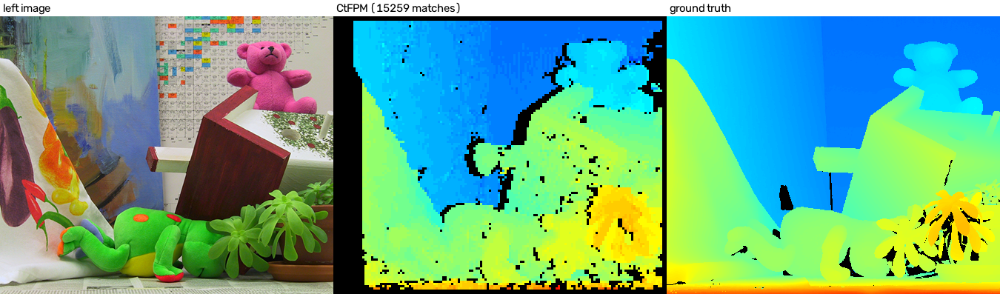

# CtFPM-GPU
***CtFPM-GPU*** is a GPU implementation (CuPy) of the coarse-to-fine PatchMatch [1] for rectified stereo images.
The original CPM [1] is for optical flow. This implementation keeps its structure and searches along the horizontal line only, so a seed has one value, the disparity:
* dense SIFT descriptors of an image pyramid ([ctfpm.py](ctfpm.py), [sift.py](sift.py), [sift.cu](sift.cu)); the filters are `cupyx.scipy.ndimage`
* seeds on a regular grid (`step` pixels) are matched from the coarsest level to the finest one: the descriptors are compared by the sum of absolute differences,
  PatchMatch (propagation from the 8 neighbors, then random search with exponentially decreasing windows) improves the disparity of a seed, and the search radius of the next level is derived from the neighbors
* the seeds are updated in parallel in 4 colors (parity of the grid x and y); the seeds of one color are never neighbors, so there is no race and the 8-neighborhood is kept
* the matching is run left to right and right to left and a seed is kept if both agree (cross check)
* the random numbers are Philox of cuRAND, so `rand_seed` makes the result reproducible

The result is **sparse**: the matches `(x, y, disparity)` of the seeds that pass the cross check, no dense disparity map.
The disparity is `x_left - x_right` (positive), the left image is the reference.



Left image, the matches on Teddy (one 3x3 square per match; black: no match) and the ground truth. 15259 of 18750 seeds pass the cross check (density 0.81), 17 % of them differ more than 1 px from the ground truth (median error 0.5 px).
With the same settings the parallel version of the CuPy implementation of CPM (the repository of CPM, 4-color version, 2-D flow with a vertical flow of 0) gives 15274 matches (one of them with a negative disparity), 17 % and 0.5 px.

## Usage
```python
# run in Python/CtFPM, in the environment of this repository
import numpy as np
import cv2
import add_path
from ctfpm import CtFPM
from ctfpm_params import ctfpm_params

# color (or gray) images, numpy float32 in 0..1 (magnitude_eps of the descriptor assumes this scale)
left = cv2.imread('../../data/teddy/im2.png') / np.float32(255)
right = cv2.imread('../../data/teddy/im6.png') / np.float32(255)
params = ctfpm_params()
matches = CtFPM(params).matching(left, right)      # (n, 3): x, y, disparity of the left image
```

| parameter | default | content |
|---|---|---|
| `ratio`, `min_width` | 0.5, 30 | scale of a pyramid level; the number of levels is `int(log(min_width / width) / log(ratio))` (3 for Teddy: widths 450, 225, 112) |
| `step` | 3 | interval of the seeds [pixel] |
| `max_iters`, `stop_iter_ratio` | 8, 0.05 | iterations of PatchMatch per level, stop when the fraction of the updated seeds gets below it |
| `max_disparity` | 400 | initial search range (symmetric around 0; at the coarsest level it is scaled by `ratio`) and the largest valid disparity |
| `min_disparity` | 0 | the smallest valid disparity: a match is removed by the cross check if its disparity, or that of the seed of the other image it falls on, is smaller (a negative value allows negative disparities) |
| `check_threshold` | 3 | the largest difference of the two disparities of the cross check [pixel] |
| `border_width` | 5 | seeds and matches closer to the left / right / top / bottom border are invalid |
| `rand_seed` | 0 | seed of the random numbers |
| `sift_*`, `grad_eps`, `magnitude_eps` | | dense SIFT (8 bins, 4x4 cells of size 2, 128 dimensions) |

The search itself is symmetric around 0 and the matches outside of [`min_disparity`, `max_disparity`] are removed after the cross check.
With `min_disparity = 0` this removes 2 of 15266 matches on Teddy; the fraction of the matches with an error above 1 px changes slitely.
A search that never proposes a negative disparity was tried instead: it gives a small amount of points more matches but no better accuracy, so the check is applied after the search.

## Notes
* The output is sparse on purpose (the principle of the method is checked here); a dense disparity map needs an interpolation of the matches.

## Reference
1. Hu, Y., Song, R., & Li, Y. (2016). Efficient coarse-to-fine patchmatch for large displacement optical flow. In Proceedings of the IEEE Conference on Computer Vision and Pattern Recognition (pp. 5704-5712).
