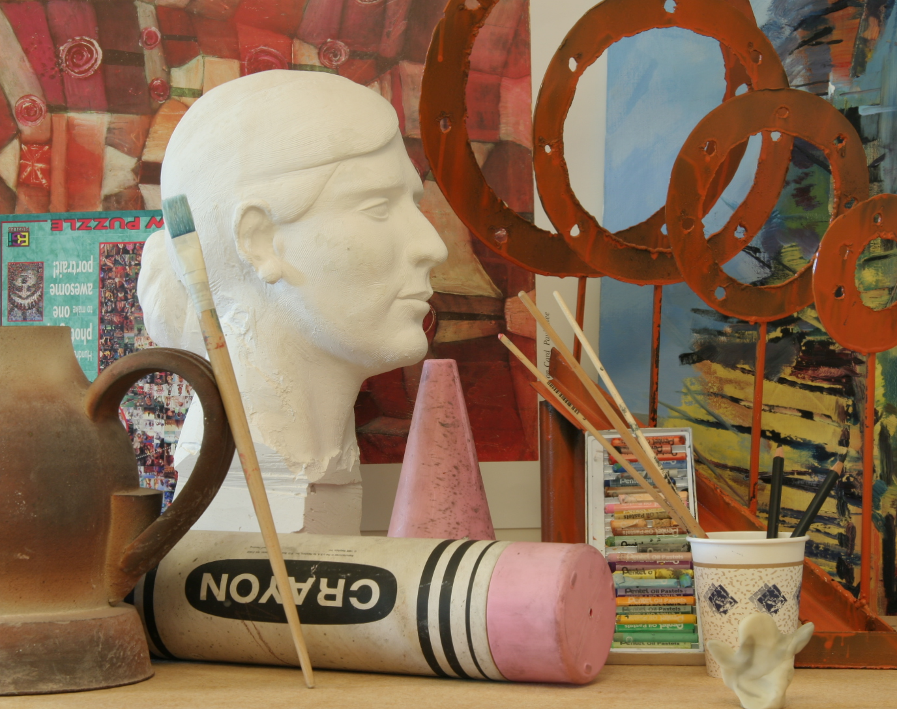
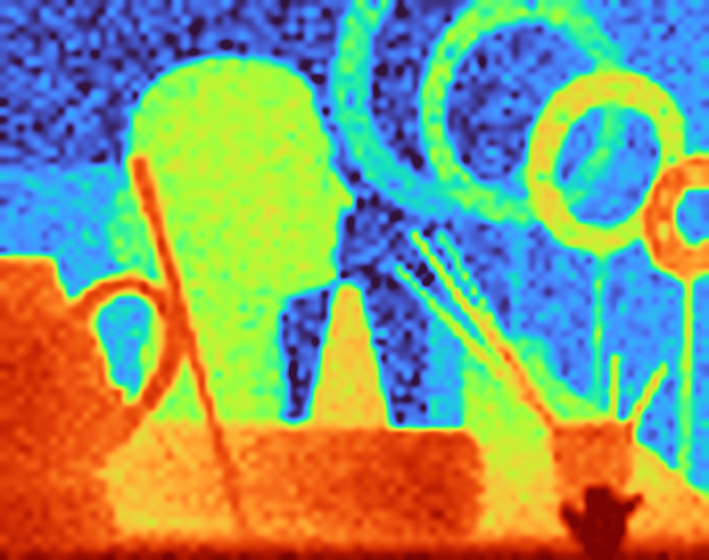
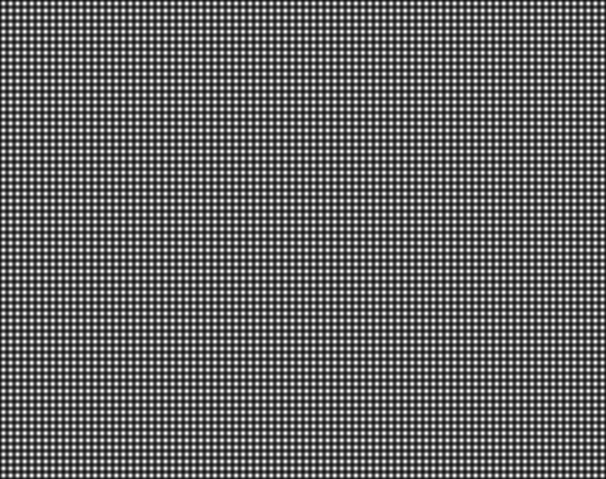
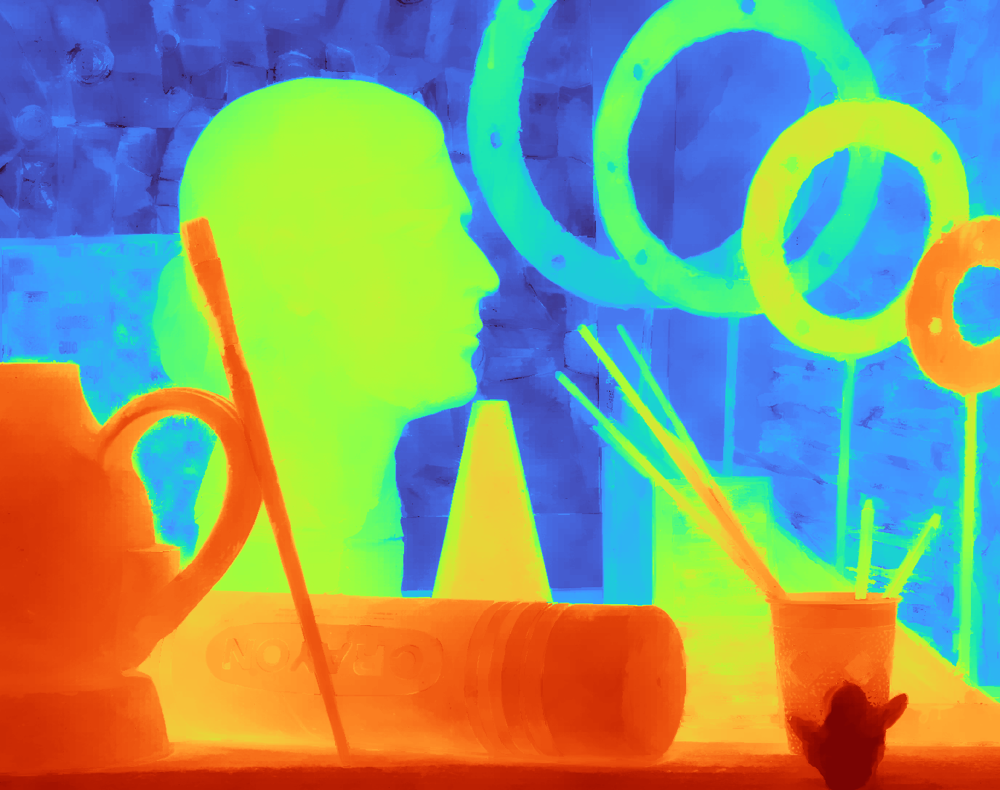
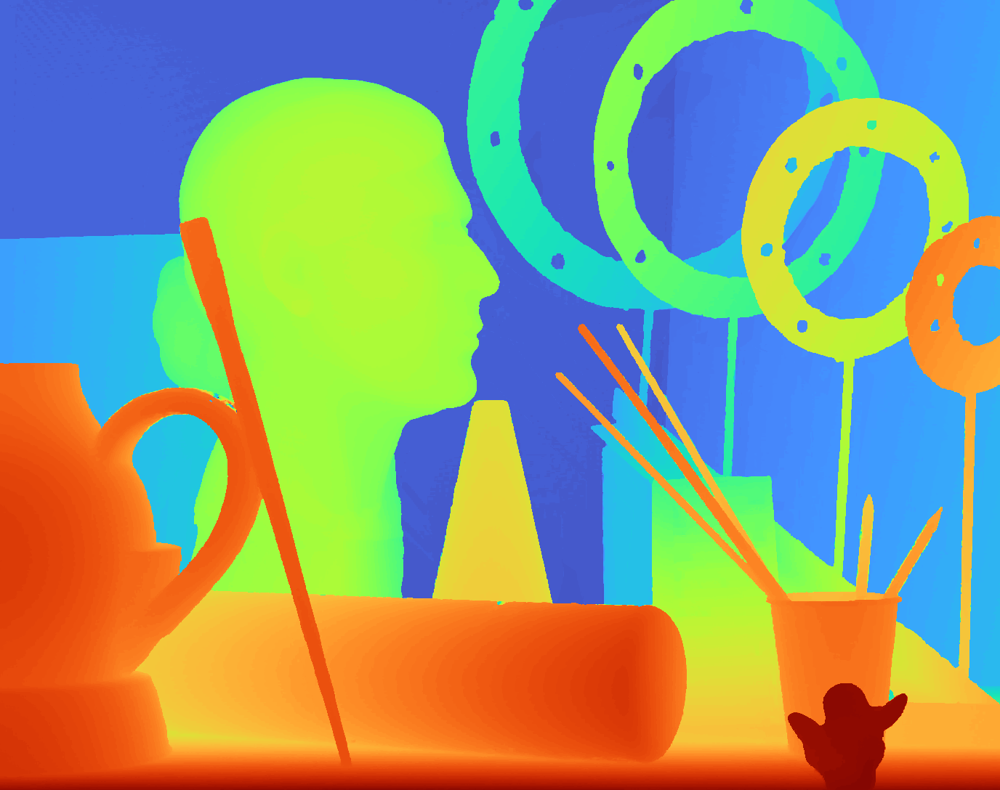
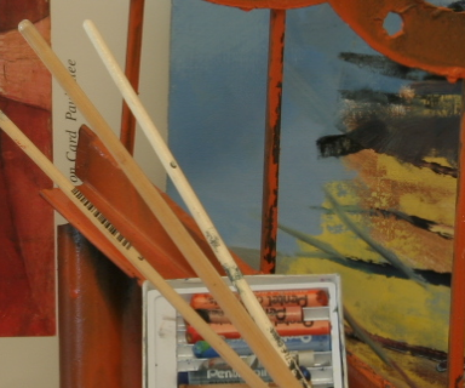
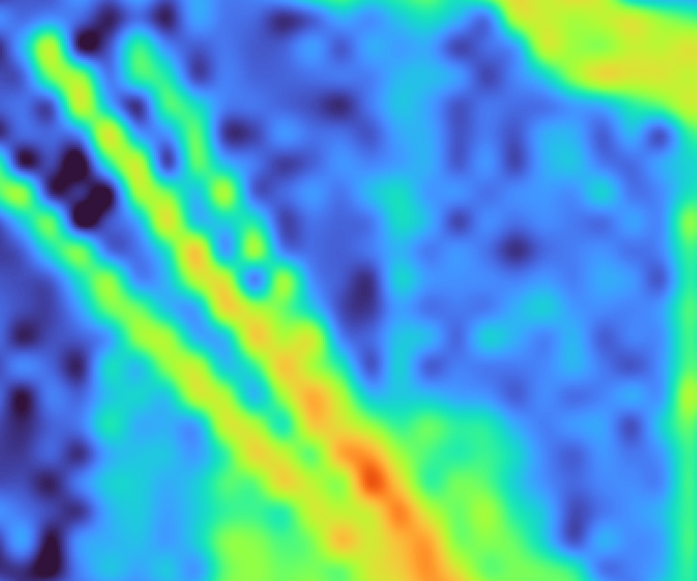
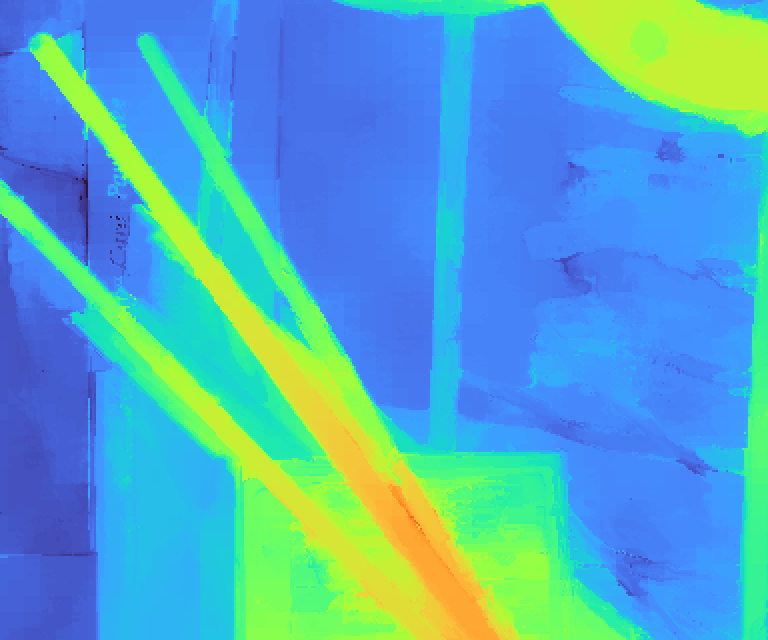
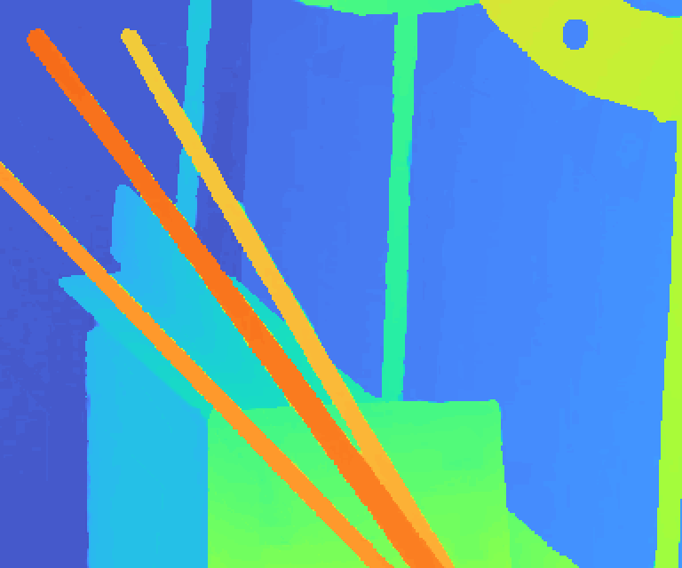

# FBS-GPU
***FBS-GPU*** is a GPU implementation of the Fast Bilateral Solver (FBS) [1] with CuPy RawModule.
It is used for the depth super-resolution: a sparse or low-resolution depth map and its confidence are filled in and upsampled, so that the depth discontinuities follow the edges of an RGB reference image.
Following the original paper, the pixels are splatted to a 5-D bilateral grid (x, y, Y, U, V), the system of the bilateral space is solved by the Jacobi preconditioned conjugate gradient without building the matrix, and the solution is sliced back to the pixels.
The kernels are in `bilateral_solver_cuda.cu`.

## Usage
```bash
python fbs_demo.py ./data/reference.png ./data/target.png ./data/confidence.png -o result.png
```
`reference.png` is the RGB image, `target.png` is the depth map and `confidence.png` is the weight of each depth pixel (0 = ignore the pixel); `--compare` compares the result with `cv2.ximgproc.fastBilateralSolverFilter` (CPU).
The same in Python:
```python
solver = BilateralSolver(BilateralSolverParams())
solver.set_reference(reference_rgb)             # (height, width, 3) uint8, RGB: builds the bilateral grid
result = solver.solve(depth, confidence)        # (height, width) float
```
The grid depends on the reference image only, so it can be reused for any number of targets.

## Example
The sample of `data` (see Sample data): the 86 x 68 disparity map `target.png` is upsampled to 1376 x 1088 by FBS-GPU with the edges of `reference.png`. The disparities are drawn with the turbo colormap on one common scale (blue = small disparity, far; red = large disparity, near). The figures are shown at 30 %; click a figure for the original.

[](./data/reference.png)

*Fig. 1. Reference image (the left image of ArtL of MiddEval3), `reference.png`.*

[](./imgs/target.png)

*Fig. 2. Target: the disparity map of 1/16 resolution, interpolated to the full resolution, `target.png`.*

[](./imgs/confidence.png)

*Fig. 3. Confidence of the target, `confidence.png` (white = 1, black = 0). It is 1 at the samples of Fig. 2 (the lattice of the period of 16 pixels) and falls between them.*

[](./imgs/result.png)

*Fig. 4. Result of FBS-GPU with the default parameters (sigma 8 / 4 / 4, lambda 128, 25 CG iterations).*

[](./imgs/ground_truth.png)

*Fig. 5. Ground truth disparity, `ground_truth.png`, scaled to the range of the target by a linear fit.*

The thin rods (x = 780 - 1163, y = 430 - 749, enlarged by 2):

[](./imgs/detail_reference.png)

*Fig. 6. Detail of the reference image.*

[](./imgs/detail_target.png)

*Fig. 7. Detail of the target (Fig. 2): the rods are blurred and the samples are visible as the lattice.*

[](./imgs/detail_result.png)

*Fig. 8. Detail of the result (Fig. 4): the disparity follows the edges of the reference image.*

[](./imgs/detail_ground_truth.png)

*Fig. 9. Detail of the ground truth (Fig. 5).*

The figures are made by `python make_figures.py ./data ./imgs`.


## Sample data
`./data/reference.png`, `target.png`, `confidence.png` and `ground_truth.png` are the files of `data/depth_superres` of the authors' repository of [1] ([poolio/bilateral_solver](https://github.com/poolio/bilateral_solver); the files are byte-identical). The repository does not document how they were made; this is what the files show.
- `reference.png` is the left image of ArtL of the Middlebury stereo benchmark MiddEval3 [2] at about the full resolution (1390 x 1110), cropped to 1376 x 1088 (a multiple of 16) around the center.
- `target.png` is a disparity map of 86 x 68 samples (1/16 of the resolution) interpolated to the full resolution (close to bicubic), scaled to 16 bit. It has a noise: at the sample points it differs from `ground_truth.png` (8 bit, the disparity of ArtL) by a standard deviation of about 23 % of that of the ground truth.
- `confidence.png` is 1 at the samples (a lattice of the period of 16 pixels, the origin at (8, 8)) and falls smoothly to about 0.3 in the middle between them.

## Reference
1. Barron, J. T., & Poole, B. (2016). The fast bilateral solver. In B. Leibe, J. Matas, N. Sebe, & M. Welling (Eds.), Computer Vision - ECCV 2016 (Lecture Notes in Computer Science, Vol. 9905, pp. 617-633). Springer.
1. Scharstein, D., Hirschmüller, H., Kitajima, Y., Krathwohl, G., Nešić, N., Wang, X., & Westling, P. (2014). High-resolution stereo datasets with subpixel-accurate ground truth. In German Conference on Pattern Recognition (pp. 31-42).
